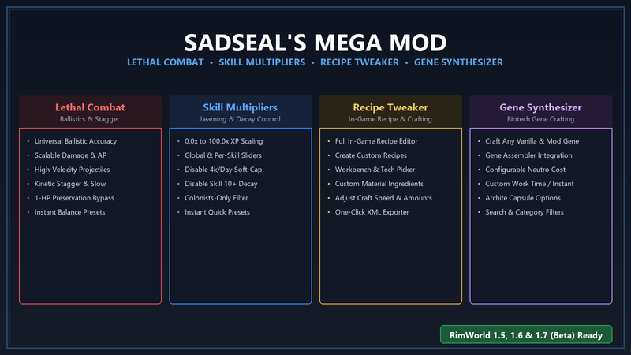

# 🦭 SadSeal's Mega Mod (Combat, Skills, Recipes, Genes, Smart Haul, Work Manager & Zero Durability Suite)

> 🇬🇧 **[Click here for the English README](README_EN.md)**

<p align="center">
  
</p>

<p align="center">
  <a href="#"></a>
  <a href="https://github.com/pardeike/HarmonyRimWorld"></a>
  <a href="#"></a>
  <a href="#"></a>
  <a href="#"></a>
</p>

<p align="center">
  <b>RimWorld deneyiminizi tepeden tırnağa geliştiren 7 entegre ana modülü (Çatışma, Yetenekler, Tarifler, Gen Sentezleme, Akıllı Taşıma, İş Yöneticisi ve Sıfır-Tick Dayanıklılık) tek bir optimize edilmiş süite altında birleştiren hepsi bir arada oyun içi yönetim paketi.</b>
</p>

---

## 🌟 Modül Özellikleri

### 1. 🏹 Ölümcül ve İsabetli Menzilli Çatışma (Lethal Combat)
* **Akıcı Balistik İsabet Formülü:** Vanilla'nın orantısız mesafe cezalarını kaldırarak yetenekli atıcıları mantıklı menzillerde ölümcül kılar.
* **4 Farklı Balistik Eğri:**
  * **Soft Ballistic (Varsayılan):** Pürüzsüz karekök düşüş eğrisi. Yüksek gerçekçilik ve dengeli çatışma.
  * **Hyperbolic:** Rasyonel düşüş eğrisi ile uzun menzilli kararlı isabet.
  * **Skill-Focused:** Yetenekli nişancıların mesafeden bağımsız yüksek isabetini korur.
  * **Vanilla:** Ayarlanabilir mesafe çarpanlı orijinal vanilla formülü.
* **Ölçeklenebilir Çarpanlar:** Mermi ham hasarı (1.00x - 2.50x), zırh delme oranı (1.00x - 2.00x) ve mermi uçuş hızı (1.00x - 2.50x) çarpanları.
* **Kinetik Sarsma (Stopping Power):** Mermilerin isabet ettiği hedefleri vücut boyutu sınırına takılmaksızın yavaşlatmasını sağlar (Centipede, Thrumbo ve yakın dövüş saldırganları sarsılır).
* **1-Can Koruma Sistemini Kaldırma:** Ağır isabet alan organların ve uzuvların yapay olarak 1 HP ile hayatta kalmasını sağlayan vanilla mekaniğini devre dışı bırakır.
* **Hazır Şablonlar:** `Vanilla+`, `Taktiksel Ölümcül`, `Sert Gerçekçilik` ve `Özel Profil`.

---

### 2. 🎓 Yetenek Öğrenme Çarpanı (Skill Multipliers)
* **Kapsamlı XP Çarpanları:** 0.0x (öğrenmeyi durdurma) ile 100.0x (ultra hızlı uzmanlık) arasında serbest ölçekleme.
* **Genel ve Bağımsız Yetenek Denetimi:** İster tek bir genel çarpan kullanın, ister Shooting, Melee, Crafting, Medicine gibi tüm vanilla ve modlu yetenekleri tek tek ayarlayın.
* **Günlük XP Yumuşak Tavanını Kaldırma:** RimWorld'ün günde 4.000 XP sonrasında uyguladığı %80 öğrenme hız cezasını tamamen iptal eder.
* **Yetenek Erimesini (Decay) Engelleme:** Seviye 10 üzerindeki yeteneklerin zamanla tecrübe puanı kaybetmesini önler.
* **Koloni Üyelerine Özel Koruma:** Çarpanların yalnızca oyuncu kolonistlerine uygulanmasını sağlayarak akıncıların ve düşmanların haksız avantaj kazanmasını engeller.
* **Usta & Efsanevi Bildirimlerini Susturma:** Yüksek çarpanlarda sık üretilen Masterwork/Legendary eşyaların ses ve mektup bildirim kirliliğini engeller.
* **Hızlı Şablon Butonları:** `1x`, `2x`, `5x`, `10x`, `25x`, `50x`, `100x` ve `Varsayılana Sıfırla`.

---

### 3. 🛠️ Tarif ve Üretim Düzenleyici (Recipe Tweaker)
* **Oyun İçi Canlı Tarif Editörü:** Tüm vanilla ve modlu tarifler (`RecipeDef`) arasında anında arama yapma ve filtreleme.
* **Üretim Süresi (İş Miktarı) Senkronizasyonu:** Tarifin `workAmount` değeri ile üretilen eşyanın `WorkToMake` statını eşzamanlı günceller.
* **Özel Malzeme Seçici:** Yüklü herhangi bir moddan malzemeleri tarife ekleme, çıkarma veya gerekli miktarları değiştirme.
* **Tarif Kapatma:** İstenmeyen veya dengesiz tarifleri tek tıklamayla oyunda devre dışı bırakma.
* **Tek Tıkla XML Yaması Dışa Aktarımı:** Yapılan tüm özel tarif düzenlemelerini standart RimWorld `PatchOperation` XML dosyası olarak (`Config/SadSealMegaMod/GeneratedPatches.xml`) dışa aktarabilme.
* **Orijinale Dönme:** Tekil veya tüm tarifleri onay pencereleri ile güvenle vanilla haline döndürme.

---

### 4. 🧬 Gen Sentezleyici (Gene Synthesizer)
* **Gene Assembler Üzerinden Doğrudan Sentez:** Gene Assembler binasında "Gen Sentezle" komutu ile dilediğiniz geni seçip saf bir `Genepack` olarak üretin.
* **Neutroamine ile Üretim:** Varsayılan 100 Neutroamine karşılığında genetik sentezleme (mod ayarlarından serbestçe değiştirilebilir).
* **Bütün Modlu Genlerle Tam Uyum:** Oyunun `DefDatabase<GeneDef>` kütüphanesini dinamik olarak tarar; Alpha Genes, Biotech Expansion ve diğer tüm gen modlarını otomatik olarak listeler.
* **Gelişmiş Arama ve Filtreleme:** Arayüzde anlık arama, mod bazında filtreleme, kategori (biyokimyasal, kozmetik, archite vb.) filtreleme ve karmaşıklık/metabolizma/archite istatistik önizlemesi.
* **Sıralı Koloni İş Akışı:** Taşıyıcı kolonistler Neutroamine'leri makineye depolar, ardından araştırmacılar çalışarak sentezi tamamlar. İptal durumunda malzemeler yere dökülerek iade edilir.
* **Hızlı Şablon Butonları:** `Bedava` (0 maliyet / anında), `Ucuz` (25 Neutroamine), `Standart` (100 Neutroamine), `Zorlu` (250 Neutroamine) ve `Varsayılana Sıfırla`.

---

### 5. 📦 Akıllı Taşıma (Smart Haul - Pick Up And Haul Varyantı)
* **Yüksek Performanslı Çoklu Taşıma:** Kolonistler tek bir eşya taşımak yerine envanter kapasiteleri dolana kadar yakındaki eşyaları da toplar.
* **Kesintisiz Toplu Boşaltma (Single-Job Batch Unload):** Orijinal Pick Up And Haul'un aksine her eşya için ThinkTree'yi baştan başlatıp TPS kaybetmez; eldeki ve çantadaki tüm eşyaları aynı iş akışı içinde sırayla depoya yerleştirir.
* **Stok Alanı Kümeleme (Affinity Cache):** Yakındaki aday eşyaların hedef depoya kabul durumunu anında kontrol ederek harita çapı ağır stok taramalarını %95 oranında baypas eder.
* **Kişisel Eşya Güvenliği:** Yalnızca taşıma amacıyla toplanan yükler etiketlenir; kolonistin yemeği, ilacı ve teçhizatı asla depoya boşaltılmaz.
* **Askere Alınma (Draft) Koruması:** Kolonist savaşa çağrıldığında taşınan yükler anında yere bırakılarak kolonist muharebeye hazır hale getirilir.
* **Hazır Şablon Butonları:** `Dengeli`, `Performans (Ultra TPS)`, `Maksimum Kapasite` ve `Varsayılana Sıfırla`.

---

### 6. 💼 Akıllı İş & Zaman Yöneticisi (Work & Schedule Manager - Work Manager 1.6 & 1.7)
* **Orijinal Mod Uyarlaması:** [LordKuper](https://steamcommunity.com/sharedfiles/filedetails/?id=2029596262)'ın sevilen **Work Manager** modunun RimWorld 1.6 ve 1.7 (.NET 10) için resmi olmayan topluluk uyarlamasıdır.
* **Modern Performans İyileştirmeleri:** Büyük kolonilerde yüksek TPS sağlamak amacıyla öncelik hesaplamaları statik tampon dizilerle optimize edilmiş, takvim kontrolleri saat başlarına (2.500 tick) bağlanmıştır.
* **Dinamik Uygunluk Puanlaması (Suitability Scoring):** Kolonistlerin yetenek seviyeleri, tutkuları (Passions), sağlık kapasiteleri (görme, manipülasyon, hareket), özellikler (Traits) ve ideoloji rollerini birleştirerek her iş türü için en yetkin kişileri belirler.
* **Uzman & Acil Durum İş Dağıtımı:** Doktorluk, Yangın ve Gardiyanlık gibi kritik görevleri acil önceliklendirirken; Aşçılık, Araştırma ve Zanaatkarlık gibi uzmanlık gerektiren alanlara harita başına sabit sayıda en yetkin uzmanları adar.
* **Boşta Kalan Kolonistleri Yönlendirme (Idle Redirection):** Kendi uzmanlık alanında iş kalmayan kolonistlerin önceliklerini otomatik esneterek taşıma ve temizlik gibi ikincil görevlere yönlendirir.
* **Akıllı Çalışma & Uyku Takvimi (Schedule Manager):** Gece Kuşu (Night Owl) kolonistleri otomatik olarak gece vardiyasına, diğer kolonistleri ise en verimli gündüz/uyku/eğlence döngüsüne 2.500 tick (1 oyun saati) aralıklarla optimize eder.
* **İş Sekmesi Doğrudan Entegrasyonu:** Koloni İş (Work) ve Takvim (Schedule) pencerelerine eklenen iki yeni sütun ile kolonist bazında otomasyonu açıp kapatabilme; sağ üst köşedeki düğmelerle anında yenileme ve toplu kontrol.
* **Hazır Şablon Butonları:** `Dengeli`, `Performans (Ultra TPS)`, `Katı Uzmanlaşma` ve `Varsayılana Sıfırla`.

---

### 7. 🛡️ Sıfır-Tick Silah ve Kıyafet Dayanıklılık Kaldırıcı (Zero-Tick Durability)
* **Sıfır-Tick Motor Mimarisi:** Periyodik tick (`compTick`) veya döngüsel kod çalıştırmaksızın doğrudan RimWorld motor düzeyinde `ThingDef.useHitPoints = false` bayrağını yönetir. %100 TPS dostudur.
* **Silah ve Teçhizat Aşınmasını Önleme:** Tüm menzilli ve yakın dövüş silahları çatışmada veya kullanımda asla hasar almaz, aşınmaz ve yıpranmaz.
* **Kıyafet ve Zırh Bozulmasını Engelleme:** Zırhlar ve giysiler dış ortam koşullarında (yağmur, kar, su), çatışmada veya zamanla hasar almaz.
* **Ruh Hali Koruması:** Kolonistler aşınmış veya parçalanmış giysi (`tattered/frayed apparel`) nedeniyle negatif ruh hali cezası almaz.
* **Tek Tıkla Tüm Eşyaları Onarma:** Mod ayarlarındaki buton ile haritadaki, envanterlerdeki ve kervanlardaki tüm yıpranmış eşyaları anında %100 kondisyona getirme seçeneği.
* **Ceset Kıyafeti (Tainted) Engelleme:** İsteğe bağlı ayar ile düşmanlar öldüğünde üzerlerindeki kıyafetlerin ceset giysisi (`tainted`) olarak etiketlenmesini engelleme desteği.
* **Hazır Şablon Butonları:** `Tümünü Devre Dışı Bırak`, `Sadece Silahlar`, `Sadece Kıyafetler`, `Her Şey Ölümsüz (Varsayılan)` ve `Varsayılana Sıfırla`.

---

## 🖥️ Kullanıcı Arayüzü & Mod Ayarları

Oyun içinde **Seçenekler ➔ Mod Ayarları ➔ SadSeal Mega Mod** menüsüne girdiğinizde üst tarafta açılır menü (dropdown) ve ok butonları (`◄ [Modül Adı] ►`) ile tüm sekmeler arasında akıcı geçiş yapabilirsiniz:

| Modül | Açıklama |
|---|---|
| `[🏹 Menzilli Çatışma]` | Balistik modeller, hasar, zırh delme ve mermi hız ayarları |
| `[🎓 Yetenek Çarpanı]` | Genel ve tekil XP katsayıları, erime ve yumuşak tavan denetimi |
| `[🛠️ Tarif Düzenleyici]` | Oyun içi canlı tarif editörü, malzeme seçici ve XML dışa aktarıcı |
| `[🧬 Gen Sentezleyici]` | Neutroamine maliyeti, üretim süresi, archite kuralları ve hazır şablonlar |
| `[📦 Akıllı Taşıma]` | Çoklu eşya toplama, arama yarıçapı, ağırlık eşiği ve stok kümeleme ayarları |
| `[💼 İş Yöneticisi]` | Öncelik hesaplama sıklığı, uzman hedefleri, takvim yönetimi ve boşta kalma kontrolleri |
| `[🛡️ Dayanıklılık]` | Silah ve kıyafet dayanıklılık iptali, tek tıkla onarma ve tainted kıyafet engelleme |

* Türkçe ve İngilizce tam dil desteğine sahiptir.
* Değişikliklerin çoğu oyun yeniden başlatılmadan anında yürürlüğe girer.

---

## 🧩 Bağımsız (Atomize Edilmiş) ve Ekosistem Mod Depoları

Mega mod süiti içerisindeki modülleri bağımsız olarak kullanmak veya ekosisteme ait diğer özel modları edinmek isterseniz aşağıdaki depolardan yararlanabilirsiniz:

* 🎓 [Rimworld-Skill-learning-multiplier](https://github.com/SadSeal5/Rimworld-Skill-learning-multiplier) - Yetenek öğrenme çarpanı ve tecrübe erimesini engelleme
* 🏹 [rimworld-lethal-ranged-combat-1.6](https://github.com/SadSeal5/rimworld-lethal-ranged-combat-1.6) - Akıcı balistik menzilli çatışma
* 🛠️ [rimworld-recipe-tweaker](https://github.com/SadSeal5/rimworld-recipe-tweaker) - Oyun içi canlı üretim tarif editörü ve XML yaması dışa aktarıcı
* 🧬 [rimworld-gene-synthesizer](https://github.com/SadSeal5/rimworld-gene-synthesizer) - Nötroamin ile saf gen paketi sentezleyici (Biotech)
* 📦 [rimworld-smart-haul](https://github.com/SadSeal5/rimworld-smart-haul) - Yüksek TPS dostu çoklu taşıma sistemi (Pick Up And Haul)
* 💼 [rimworld-work-manager](https://github.com/SadSeal5/rimworld-work-manager) - Otomatik iş ve takvim yöneticisi (Work Manager 1.6 & 1.7)
* 🛡️ [rimworld-no-durability](https://github.com/SadSeal5/rimworld-no-durability) - Sıfır-tick silah ve kıyafet dayanıklılık kaldırıcı
* 🧪 [Rimworld-Unified-Research-Tree](https://github.com/SadSeal5/Rimworld-Unified-Research-Tree) - Tüm DLC ve modlu araştırmaları tek sonsuz tuvalde toplayan, Anomaly ikili çalışma destekli ve otomatik kuyruklu modern araştırma ağacı
* 🩸 [SadRimworld-Cellular-Regeneration](https://github.com/SadSeal5/SadRimworld-Cellular-Regeneration) - 4 aşamalı öncelikli iyileşme hatlı (kanama pıhtılaşma, yara kapanması, uzuv yenileme, kalıcı yara izi tedavisi) hücresel rejenerasyon gen paketi

---

## ⚙️ Gereksinimler & Yükleme Sırası

* **RimWorld Sürümleri:** `1.5`, `1.6` veya `1.7` (Beta)
* **Gerekli Mod:** [Harmony (brrainz.harmony)](https://github.com/pardeike/HarmonyRimWorld)

```
1. Core (RimWorld)
2. Harmony
... (Diğer Modlar)
X. SadSeal's Mega Mod
```

---

## 📁 Kurulum

1. Deponun en son sürümünü [Releases](https://github.com/SadSeal5/SadRimworld-mod-pack/releases) sayfasından indirin veya depoyu klonlayın.
2. Klasörü RimWorld mod dizininize yerleştirin:
   ```
   RimWorld/Mods/SadSealMegaMod/
   ```
3. Oyunu başlatın, Mod Yöneticisi'nde Harmony'nin altına SadSeal's Mega Mod'u ekleyin ve etkinleştirin.

---

## 🙏 Teşekkürler & Krediler (Credits & Attribution)

* **Work Manager:** Fikir, tasarım ve arayüz konsepti için [LordKuper](https://steamcommunity.com/sharedfiles/filedetails/?id=2029596262)'a teşekkür ederiz. Bu modüldeki Work Manager, orijinal modun modern RimWorld 1.6 & 1.7 (.NET 10) sürümlerine topluluk uyarlamasıdır.
* **Smart Haul:** *Pick Up And Haul* konsepti ve orijinal mod fikirleri için topluluk geliştiricilerine teşekkürler.
* **Unified Research Tree:** Orijinal *Research Tree* ve *Research Reinvented* konseptlerinden ilham alan, modern RimWorld 1.6 & 1.7 (.NET 10) ve Anomaly DLC için sıfırdan tasarlanan DAG auto-layout araştırma ağacı.
* **Geliştirici & Paket:** SadSeal5 tarafından geliştirilip sürdürülmektedir.
